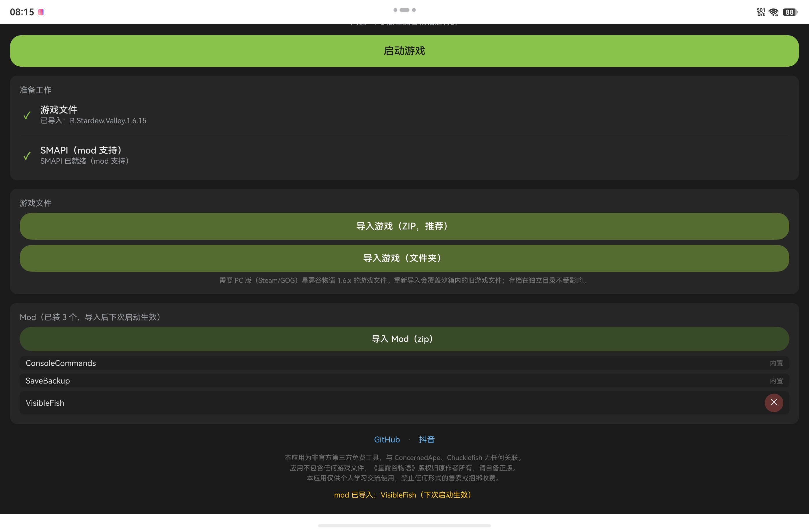
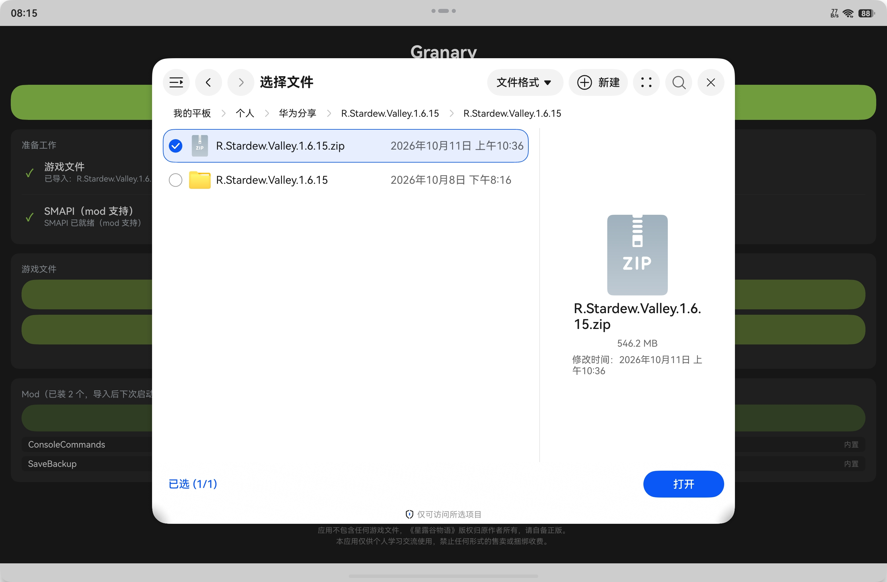
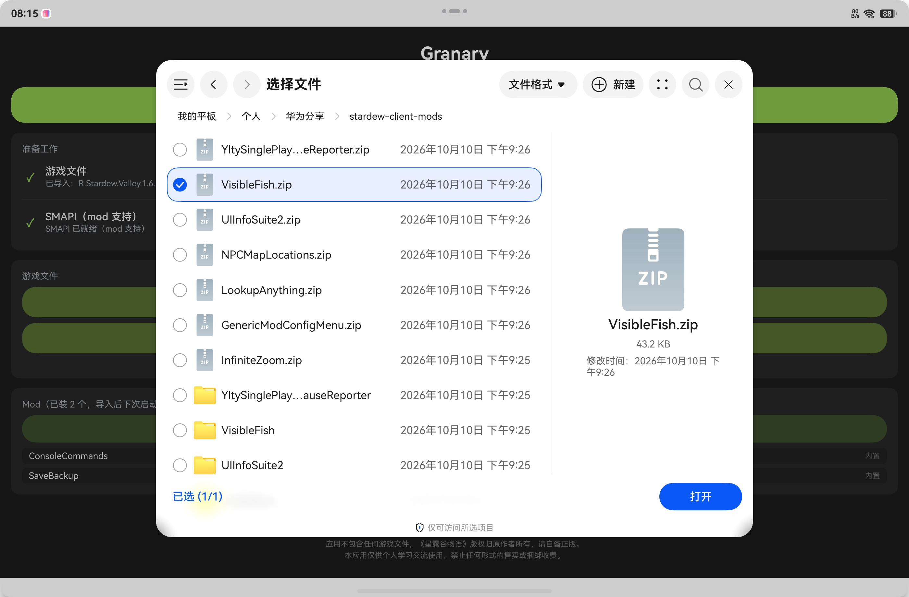
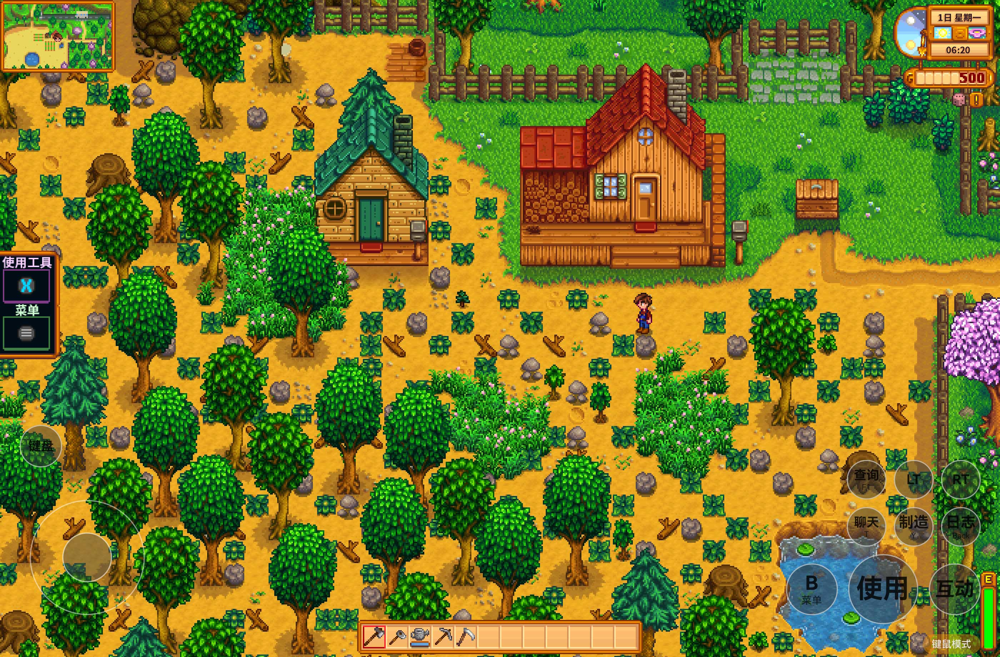

# Granary

在 **HarmonyOS NEXT（纯血鸿蒙）** 手机 / 平板 / PC 上运行 **PC 版**《星露谷物语》的启动器。

📺 演示视频与使用教程见抖音：[点此关注](https://www.douyin.com/user/MS4wLjABAAAAndgN-tv6BKSDjhY-iN0T2q0u5lmq2P1pwPmFhQxQLqM?from_tab_name=main)

通过网盘分享的文件：R.Stardew.Valley.1.6.15.rar
链接: https://pan.baidu.com/s/1nmnrhR2EVlIOrrsgVYLokw 提取码: 8mmb 

<!-- 截图：0 主界面 / 1 导入游戏 / 2 导入 mod / 3 触屏手柄模式 / 4 蓝牙键鼠模式 -->

## 界面预览

|  |  |
| :---: | :---: |
| 导入游戏 | 导入 mod |

|  |  |
| :---: | :---: |
| 触屏手柄模式（裸奔平板可玩） | 蓝牙键鼠模式 |

## 多种操作方式

游戏内右下角按钮一键切换，三种模式随时换：

### ⌨️ 键鼠模式

蓝牙 / USB 键鼠直连，桌面级操作体验。接物理键盘后点「键盘」按钮唤起系统输入法，游戏内可直接打拼音输入中文（起名、联机聊天都能用）。

### 🎮 触屏手柄模式

不带任何外设、裸奔平板可玩——屏幕叠加虚拟手柄图层：左侧摇杆、右侧 A/B/X/Y 动作键、LT/RT 扳机，以及「查询 F1」「聊天 T」等常用键。

物理蓝牙手柄同样支持：A/B/X/Y、L1/R1、Select/Start、十字键、**摇杆与 LT/RT 扳机**（v0.2.4 起）全部可用，且可与触屏图层、键鼠同时混用——比如左手摇杆右手鼠标。

### 👆 触屏模式（点击移动）

像玩手机游戏一样直接点地面走路、点目标互动（开发中，目前仅支持点击移动）。

## 功能特性

- 完整运行 PC 版星露谷物语（1.6.15 实测），OpenGL 渲染，实测 60fps
- 蓝牙 / USB 键鼠直连，桌面级操作体验
- 触屏虚拟手柄模式——不带键盘也能玩（左摇杆 + 常用按键图层，游戏原生手柄支持）
- SMAPI 4.5.2 mod 支持，兼容桌面 mod（Linux 代码路径）
- 联机可用（含 Lidgren 网络栈所需的 OpenSSL / LZ4 原生库）
- 存档管理：启动器内查看 / 导出 / 导入 / 删除存档
- 中文输入：接通系统输入法，游戏内起名、联机聊天可输入中文

## 系统要求

- HarmonyOS NEXT 手机 / 平板 / PC（已在 Mate X6 手机、MatePad（MRDI-W00）平板、PC 实测）
- 蓝牙或 USB 键鼠（可选，触屏模式可不接）
- 预留约 4GB 存储空间（应用 + 游戏文件）

## 安装（侧载）

Granary 不上架华为应用市场，需要侧载安装：

1. 下载 Release 中的 `.hap` 安装包
2. 按照侧载教程安装：<https://www.sydxky.cn>（国内推荐渠道，含完整教程）
3. 安装后在桌面出现 Granary 图标

## 游戏文件准备（重要）

Granary **不包含任何游戏文件**。你需要：

- 自行拥有 PC 版星露谷物语（[Steam](https://store.steampowered.com/app/413150/) 正版）
- 在启动器中通过「选择目录」或「zip 导入」将游戏文件传入应用沙箱

## 免责声明

- 本项目为非官方第三方工具，与 ConcernedApe、Chucklefish 无任何关联
- 《星露谷物语》(Stardew Valley) 名称与内容版权归原作者所有
- 本工具仅提供运行环境，不分发、不包含任何游戏资产，请支持正版
- 本工具**永久免费**，仅供个人学习交流使用，**禁止任何形式的售卖或捆绑收费**

## 已知问题与计划

- [ ] Steam 登录直接下载游戏（开发中）

版本更新内容见 [CHANGELOG.md](CHANGELOG.md)。

问题反馈请提 [Issues](../../issues)。

## 致谢

- [Cinderbox (Android)](https://www.nexusmods.com/stardewvalley/mods/43278) / [Ekyso/Cinderbox](https://github.com/Ekyso/Cinderbox) —— 安卓版先行者，本项目架构参考
- [SMAPI](https://smapi.io/) —— mod 加载框架
- [SDL3](https://www.libsdl.org/) / [OpenAL Soft](https://openal-soft.org/) / OpenSSL / lz4

## 许可证

本仓库仅发布二进制安装包，源代码不开源。所含第三方开源组件的许可证见 [THIRD_PARTY.md](THIRD_PARTY.md)。
